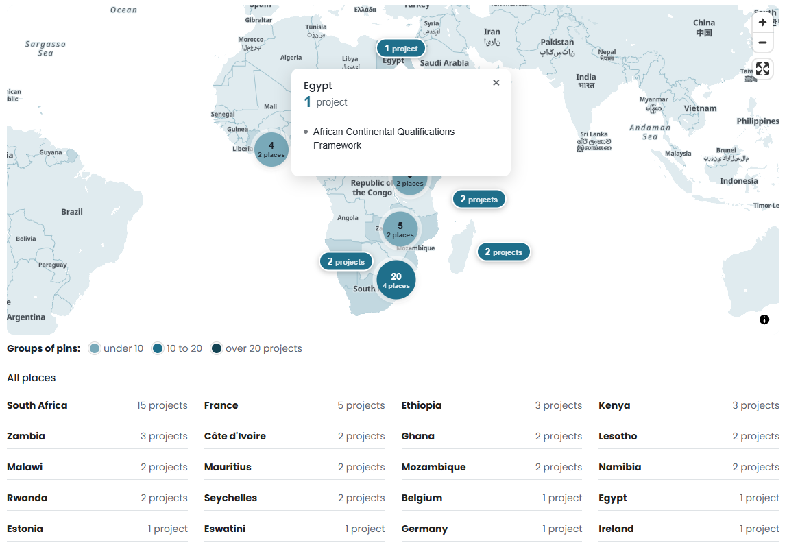

# juizi.maps

A **Map** block for Plone 6 / Volto: places on a street map in the site's
colours, as pins, pins with totals, shaded countries or provinces, or
offices with their contact details.

- **Backend:** `juizi.maps` (Plone 6.1). One settings record for the whole
  site (which map styles editors may choose, where "Get directions"
  goes), the `@juizi-maps-settings` service, and example pages.
- **Frontend:** `volto-juizi-maps` (Volto 18). The Map block, its location
  picker, and Site Setup → Maps.

Status: alpha (1.0.0a0), first built November 2026. Where the work stands:
[PROGRESS.md](PROGRESS.md); every design decision and why:
[DECISIONS.md](DECISIONS.md).



*Pins with totals, on plain Volto: nearby pins group and add up, groups are coloured by size (key under the map), a pop-up lists a place's projects, and every place is also in the list below.*

## Where it comes from

Two existing blocks showed what Juizi sites needed from a map, and what
they were missing:

- [codesyntax/volto-maplibre-block](https://github.com/codesyntax/volto-maplibre-block)
  (MIT): a MapLibre map with pins and a pop-up text per pin.
- volto-juizi-maplibre-counting-block (Juizi, private): an extension of it
  that groups nearby pins and counts them, used on JET's project maps.

juizi.maps is **a new block, not an extension, fork or upgrade of either**.
It shares no code with them, registers its own block type (`juiziMap`, not
their `mapLibreBlock`) and doesn't read their saved data, so the two can sit
side by side on a site while maps are moved over. Moving a map means
rebuilding it with this block: the fields are different (a place has a
number, figures, items, a link, a picture and contact details where the
older blocks had one plain text box). What we took from them is the idea and
the lessons: pins grouped and counted is worth keeping; one plain-text
pop-up, a fixed look and a non-open-source map library (mapbox-gl 3.x in
the counting block) weren't.

## What editors get

Choose a **display style** first:

| Style | For |
|---|---|
| Pins on a map | a pin per place; click for its details |
| Pins with totals | each pin shows a number ("16 schools"); nearby pins group and add up, groups coloured by size |
| Shaded regions | countries or South African provinces coloured by their total, darker is more; regions too small to see get a dot |
| Places with contact details | offices or venues: address, phones (a second one can be WhatsApp), email, hours, "Get directions", beside or under the map |

Then add places in the sidebar: a name, where it is (click the small map,
drag the pin, or paste coordinates or a Google Maps link), and what the
pop-up shows: a number, figures, a summary, a list of items (pages on the
site or plain text), a link, a picture, contact details.

Visitors always get the places as a list too (visible by default, or for
screen readers only), so nothing is only in the map.

## Accessibility and search engines

- The places are always in the page's HTML as a list (with their numbers,
  figures, items and contact details), so screen readers and search
  engines get everything without the map.
- Each pin is one button (one tab stop) that opens its pop-up; the list's
  places open the same pop-up.
- Pop-ups are dialogs named by their place, close on Escape and give focus
  back to what opened them.
- Pin and group labels keep 4.5:1 contrast: a pin colour too light for its
  text is darkened just enough.
- Checked with axe at desktop and phone widths and with the keyboard: no
  serious findings. One moderate one remains on pages with no `<h2>` before
  the map, where its "All places" `<h3>` skips a level. A person's
  screen-reader test (NVDA, VoiceOver) is still to do (PROGRESS.md).

Full editor documentation and the draft happy path:
[the block's README](frontend/packages/volto-juizi-maps/src/components/Blocks/Map/README.md).

## Works with

- **Plain Volto 18** (no Volto Light Theme, no juizi-blocks): tested on the
  vanilla dev site below.
- **Volto Light Theme**: tested on JET (VLT 7.8.5). On VLT pages the
  block keeps a phone-width gutter of its own (VLT only gives one to its own
  blocks).
- **juizi-blocks**: optional. When installed, the map offers the site
  colours from Site Setup → Juizi Blocks, sits in the Juizi group of the
  block chooser, and its settings appear as a **Maps** tab on the Juizi
  Blocks dashboard. Neither add-on imports the other: juizi-blocks
  registers a `blockExtension` utility named `juiziMap`, juizi.maps
  registers a `juiziDashboardTab` utility. (The juizi-blocks side isn't in
  juizi-blocks main yet; see PROGRESS.md. Until it is, the map uses its own
  colours as below.)
- **Cookie banner** (volto-gdpr-privacy with collective.volto.gdprcookie):
  optional. On a site with the banner, the map loads nothing from
  OpenFreeMap until the visitor agrees. If the banner has a choice for maps
  (a reference URL of `openfreemap.org`, or the key `MAPS`), the map follows
  it; otherwise it follows the visitor's answer as a whole. Until then the
  map shows a note offering "Enable Maps cookies" (or "Show the map this
  time" when the banner has no maps choice) and a link to the cookie
  preferences. Editors
  always get the map. juizi.maps doesn't import the banner add-on; it reads
  what the banner leaves (its settings, state and cookie).

Without juizi-blocks the map offers its own colours (see
[Colours without juizi-blocks](#colours-without-juizi-blocks)). Pale colours (white, light grey) are never used as the map's main or
default pin colour, since they vanish on a light map.

## Map tiles and data

- Street maps: [OpenFreeMap](https://openfreemap.org) (free, no key, no
  cookies). "Street map in the site's colours" recolours its Positron
  style in the browser; the standard street map is its Liberty style.
- Country and province shapes: [Natural Earth](https://www.naturalearthdata.com)
  (public domain), simplified, bundled in `src/data/geo.json` (150 KB
  gzipped), loaded only by maps that need them.
- maplibre-gl 5.24.0, loaded only in the browser, after the page renders.

## Dependencies

| | Needs | Optional |
|---|---|---|
| Backend `juizi.maps` | Plone 6.1 (`Products.CMFPlone` 6.1.5), `plone.api`, `plone.restapi`, `plone.volto`; Python 3.12 or later | |
| Frontend `volto-juizi-maps` | Volto 18, Node.js 22, pnpm; [maplibre-gl](https://maplibre.org) 5.24.0 (installed with the add-on, BSD-3-Clause) | juizi-blocks (site colours, dashboard tab), Volto Light Theme, volto-gdpr-privacy (cookie consent) |
| Map data | [OpenFreeMap](https://openfreemap.org) tiles, fetched by the visitor's browser: no key, no account, no cookies | |

Nothing else to install: no API key, no tile server, no other Volto
add-on. The country and province shapes ship with the add-on.

## Installation

Two parts, like every Juizi add-on with a backend: the backend package
**`juizi.maps`** stores the site's map settings and serves them; the Volto
add-on **`volto-juizi-maps`** has the block and Site Setup → Maps. A backend
can serve several sites: add the backend package once, the frontend add-on
to each site that should have maps.

### 1. Backend

With mxdev, add a section to the backend's `mx.ini`:

```ini
[juizi.maps]
url = git@github.com:juizi-com/juizi-maps.git
pushurl = git@github.com:juizi-com/juizi-maps.git
branch = main
subdirectory = backend
```

and `juizi.maps` to the dependencies in the backend's `pyproject.toml`.
Without mxdev, depend on the git URL directly (uv or pip):

```text
juizi.maps @ git+https://github.com/juizi-com/juizi-maps.git@main#subdirectory=backend
```

The repository is private: the server needs read access to it (a deploy key
or a token). Run `make install` and restart the backend. The package loads
itself (`plone.autoinclude`); there's no ZCML to add, and nothing is
installed on any site yet.

### 2. Frontend

Add the repository to the frontend's `mrs.developer.json`:

```json
"juizi-maps": {
  "output": "./packages",
  "package": "volto-juizi-maps",
  "url": "git@github.com:juizi-com/juizi-maps.git",
  "https": "https://github.com/juizi-com/juizi-maps.git",
  "path": "frontend/packages/volto-juizi-maps",
  "branch": "main"
}
```

then to the frontend's `package.json` dependencies:

```json
"volto-juizi-maps": "workspace:*"
```

and to the add-ons in `volto.config.js`, before the site's own add-on (and
after juizi-blocks and Volto Light Theme when the site has them):

```js
const addons = ['volto-juizi-blocks', 'volto-juizi-maps', 'volto-<site>'];
```

pnpm finds it through the workspace pattern `packages/**/packages/*` (in
`pnpm-workspace.yaml`; Cookieplone projects have it). Run `make install`
and rebuild or restart the frontend.

### 3. Install on the site

In **Site Setup → Add-ons**, install **Juizi Maps**. The Map block then
appears in the block chooser, and **Site Setup → Maps** (or the Maps tab on
the Juizi Blocks dashboard) sets which map styles editors may choose and
where "Get directions" goes. Until it's installed, the frontend offers it
there and shows none of it, so the frontend can be deployed first; on a
backend shared by several sites, it stays hidden on sites that don't have
it. **Juizi Maps: example pages** adds a `/maps` folder of examples (for
development sites).

### Colours without juizi-blocks

A site without juizi-blocks sets the colours editors choose from in its own
add-on:

```js
config.blocks.blocksConfig.juiziMap.colours = [
  { value: '#00958e', label: 'Turquoise' },
  { value: 'var(--dark-turquoise)', label: 'Dark turquoise' },
];
```

Otherwise five standard colours are offered (`src/settings/colours.js`).

### Updating

Pull the new version (mxdev / mrs-developer, `make install`), restart the
backend and rebuild the frontend.

## Development

```sh
cd backend && make install && make create-site && make start   # :8098, site "Plone"
cd frontend && make install && pnpm start                        # :3018
```

Log in as admin/admin. Example pages are under `/maps` (from the
`juizi.maps:initial` profile that `create-site` runs).

Tests:

```sh
cd backend && .venv/bin/pytest          # 20 tests
cd frontend && CI=true pnpm test        # 46 tests
cd frontend && pnpm lint
```
